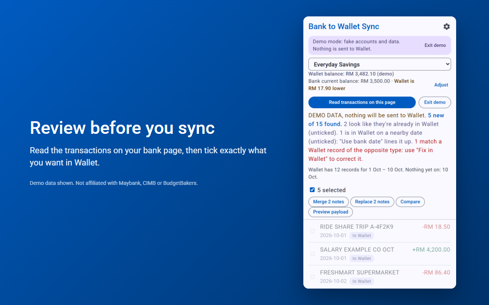

# Bank to Wallet Sync

> **A note on this project:** I built this for my own use and to share with friends. It does what I need and isn't a polished product, but if it fits your needs too, you're more than welcome to use it. Issues and suggestions are welcome, though I can't promise to act on them quickly.

A Chrome/Edge extension. You log in to your bank yourself as usual; the extension only reads the transaction table already on screen and adds new rows to BudgetBakers Wallet via the official REST API.

**Supported banks:** Maybank2u (M2U) for now. The page reader is in `scanner.js`, and the popup only runs on `maybank2u.com.my` pages (see `host_permissions` in `manifest.json` and the URL check in `popup.js`) — more banks would need an entry in both.



## Install
1. Open `chrome://extensions` (or `edge://extensions`), turn on **Developer mode**.
2. Click **Load unpacked** and pick this folder.
3. Open the extension's **Settings**, paste your Wallet API token (Wallet web app → Settings → REST API, Premium only), click **Load accounts**, pick the account that mirrors your Maybank account, save.

## Use
1. Log in to Maybank2u and open the account's transaction history.
2. Click the extension icon → **Read transactions on this page**.
3. Untick anything you don't want, then **Add to Wallet**.

## How duplicates are avoided
Nothing is written into Wallet to track what was synced. Before showing the list, the extension fetches the account's existing records for the date range and compares each transaction by date, amount and description (ignoring case, spacing and punctuation, and allowing for Wallet cutting descriptions short). Matches are paired one-to-one, so two identical coffees on the same day need two Wallet records.

- **In Wallet:** same date, amount and description.
- **Likely in Wallet:** same date and amount, different description. It's left unticked and shows the Wallet description. **Replace** sets that Wallet record's note to the bank's description. The payer, category and labels are never touched, and new records are created without a payer too (the description goes in the note).

Records synced by older versions carry a `[m2u:…]` tag in their note. It's ignored when reading and not written any more, so you can delete it from those notes if you like.

## Before your first real sync
- Click **Preview payload** and compare the fields with the `POST /v1/api/records` schema in the API explorer: https://rest.budgetbakers.com/wallet/openapi/ui. Adjust `toWalletRecord()` in `wallet.js` if names differ.
- Try it with one transaction first.

## If it says "No transaction table found"
The scanner looks for HTML tables or ARIA grids with a date column and an amount (or debit/credit) column. If Maybank2u lays the history out differently, `scanPage()` in `scanner.js` needs adjusting to the real page structure.

## Limits
- Wallet allows 300 API requests/hour; one read + sync uses a handful.
- Categories come from your Wallet rules (Settings → Rules in Wallet). Wallet only applies those to bank-sync and GPay imports, so the extension reads them through the API and sets the category (and labels) itself when a keyword matches the bank description. Transactions no rule matches are created without a category.

## Privacy
Everything runs in your browser and talks only to the Wallet API with your own token. No analytics, no developer server. See [PRIVACY.md](PRIVACY.md).

## Publishing to the Chrome Web Store
Listing text, permission justifications and data-usage answers are in [store/LISTING.md](store/LISTING.md), with 1280×800 screenshots and a small promo tile alongside. A ready-to-upload build is in [dist/bank-to-wallet-sync-0.1.1.zip](dist/bank-to-wallet-sync-0.1.1.zip). To rebuild it, zip these files (not `store/`, `.git` or docs) with `manifest.json` at the zip root:

```
manifest.json background.js popup.html popup.js unsupported.html options.html options.js scanner.js wallet.js demo.js style.css icons/icon-16.png icons/icon-32.png icons/icon-48.png icons/icon-128.png
```

## License
[MIT](LICENSE). Not affiliated with or endorsed by Malayan Banking Berhad or BudgetBakers.
